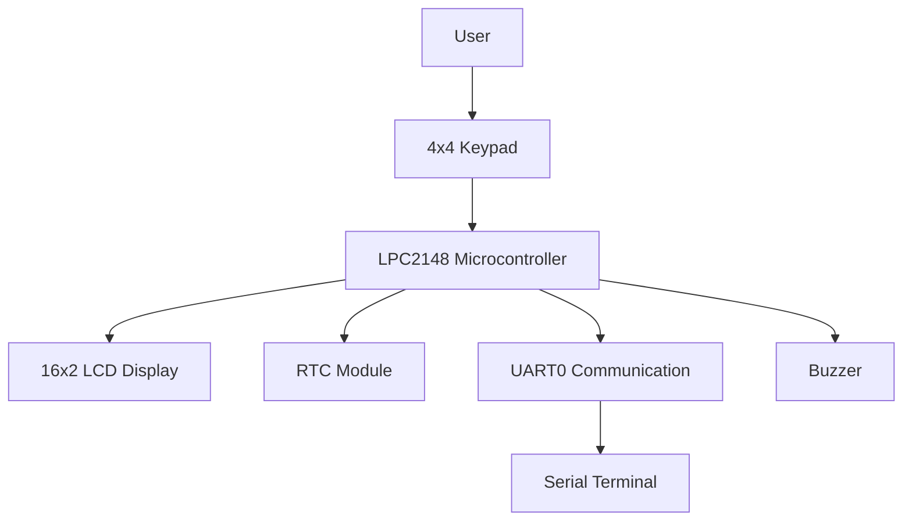

# ATM Simulator with Real-Time Transaction Logging using LPC2148

## 1. Project Overview

The ATM Simulator with Real-Time Transaction Logging is an embedded systems project developed using the LPC2148 ARM7 microcontroller.

This project simulates basic ATM operations such as:

- User authentication
- Balance enquiry
- Cash withdrawal
- Cash deposit
- PIN change
- Transaction history

The system uses a 16x2 LCD to display information, a 4x4 matrix keypad for user input, an internal RTC to maintain date and time, and UART communication to transmit transaction details to a computer.

An external interrupt is used to access the RTC date and time editing menu.

## 2. Project Objectives

1. To develop an ATM simulation using the LPC2148 microcontroller.
2. To implement PIN-based authentication.
3. To perform cash withdrawal and deposit operations.
4. To display the available account balance.
5. To maintain transaction history.
6. To implement RTC-based date and time.
7. To transmit transaction details through UART.
8. To implement external interrupt functionality.

## 3. Project Features

- PIN-based login authentication.
- Three-attempt login restriction.
- Balance enquiry.
- Cash withdrawal.
- Cash deposit.
- PIN change.
- Transaction history.
- Real-Time Clock.
- External interrupt for RTC editing.
- UART-based transaction logging.
- LCD display.
- Buzzer indication.

## 4. Hardware Requirements

- LPC2148 ARM7 Microcontroller
- 16x2 LCD Display
- 4x4 Matrix Keypad
- Buzzer
- Push Button
- Computer
- USB-to-UART Interface

## 5. Software Requirements

- Keil µVision IDE
- Embedded C Programming
- Flash Magic
- UART Serial Terminal
## 6. System Architecture

The ATM Simulator uses the LPC2148 microcontroller as the main controller. The keypad is used to enter the PIN and select ATM operations. The LCD displays messages and account details. The RTC provides date and time information, while UART0 sends transaction details to the serial terminal.

### System Block Diagram

### Working Principle

1. The user enters the PIN using the keypad.
2. The LPC2148 checks the entered PIN.
3. After successful login, the ATM displays the available operations.
4. The user selects deposit, withdrawal, balance enquiry, or transaction history.
5. The RTC provides the current date and time.
6. Transaction details are transmitted through UART0.
7. The LCD displays the transaction result.
