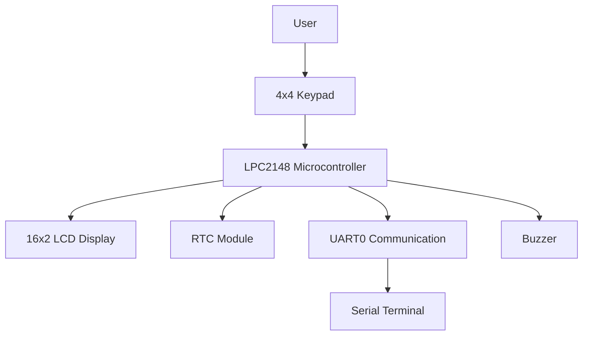
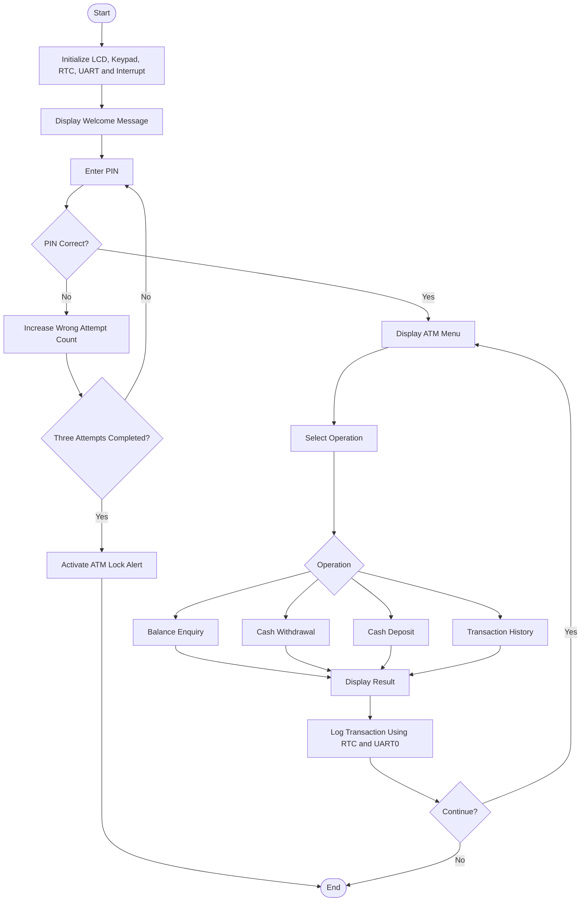
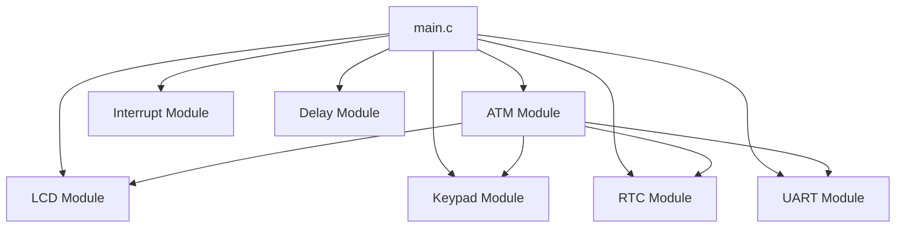

# ATM Simulator with Real-Time Transaction Logging using LPC2148

## 1. Project Overview

The ATM Simulator with Real-Time Transaction Logging is an embedded systems project developed using the LPC2148 ARM7 microcontroller.

This project simulates basic ATM operations such as:

- User authentication
- Balance enquiry
- Cash withdrawal
- Cash deposit
- PIN change
- Transaction history

The system uses a 16x2 LCD to display information, a 4x4 matrix keypad for user input, an internal RTC to maintain date and time, and UART communication to transmit transaction details to a computer.

An external interrupt is used to access the RTC date and time editing menu.

## 2. Project Objectives

1. To develop an ATM simulation using the LPC2148 microcontroller.
2. To implement PIN-based authentication.
3. To perform cash withdrawal and deposit operations.
4. To display the available account balance.
5. To maintain transaction history.
6. To implement RTC-based date and time.
7. To transmit transaction details through UART.
8. To implement external interrupt functionality.

## 3. Project Features

- PIN-based login authentication.
- Three-attempt login restriction.
- Balance enquiry.
- Cash withdrawal.
- Cash deposit.
- PIN change.
- Transaction history.
- Real-Time Clock.
- External interrupt for RTC editing.
- UART-based transaction logging.
- LCD display.
- Buzzer indication.

## 4. Hardware Requirements

- LPC2148 ARM7 Microcontroller
- 16x2 LCD Display
- 4x4 Matrix Keypad
- Buzzer
- Push Button
- Computer
- USB-to-UART Interface

## 5. Software Requirements

- Keil µVision IDE
- Embedded C Programming
- Flash Magic
- UART Serial Terminal
## 6. System Architecture

The ATM Simulator uses the LPC2148 microcontroller as the main controller. The keypad is used to enter the PIN and select ATM operations. The LCD displays messages and account details. The RTC provides date and time information, while UART0 sends transaction details to the serial terminal.

### System Block Diagram

### Working Principle

1. The user enters the PIN using the keypad.
2. The LPC2148 checks the entered PIN.
3. After successful login, the ATM displays the available operations.
4. The user selects deposit, withdrawal, balance enquiry, or transaction history.
5. The RTC provides the current date and time.
6. Transaction details are transmitted through UART0.
7. The LCD displays the transaction result.
## 7. Hardware Interfacing

The LPC2148 microcontroller is connected to different hardware components to perform ATM operations.

The following components are interfaced with the microcontroller:

- 16x2 LCD Display
- 4x4 Matrix Keypad
- Real-Time Clock (RTC)
- UART0 Communication
- Buzzer
- External Interrupt Button

### 7.1 LCD Interfacing

A 16x2 LCD is used to display ATM messages, PIN entry prompts, account balance, and transaction status.

**LCD Pin Connections**

| LCD Pin | LPC2148 Pin |
|---|---|
| D0-D7 | P0.8-P0.15 |
| RS | P0.16 |
| RW | P0.17 |
| EN | P0.18 |

### 7.2 Keypad Interfacing

A 4x4 matrix keypad is used to enter the ATM PIN, select menu options, and enter transaction amounts.

**Keypad Pin Connections**

| Keypad Pins | LPC2148 Pins |
|---|---|
| Row 1 | P1.16 |
| Row 2 | P1.17 |
| Row 3 | P1.18 |
| Row 4 | P1.19 |
| Column 1 | P1.20 |
| Column 2 | P1.21 |
| Column 3 | P1.22 |
| Column 4 | P1.23 |

**Working:**

1. The microcontroller scans the keypad rows and columns.
2. When a key is pressed, the corresponding row and column are identified.
3. The pressed key value is returned to the ATM program.
4. The entered value is used for PIN verification or ATM operations.

### 7.3 Real-Time Clock (RTC) Interfacing

The internal RTC (Real-Time Clock) of the LPC2148 is used to maintain the current date and time.

The RTC provides timestamp information for ATM transactions.

**Working:**

1. The RTC is initialized during system startup.
2. It maintains the current date and time.
3. When a transaction occurs, the ATM reads the RTC values.
4. The date and time are included in the transaction log.
5. The transaction details are transmitted through UART0.

**RTC Registers Used:**

- `CCR` – Controls RTC operation.
- `PREINT` – Integer part of the prescaler.
- `PREFRAC` – Fractional part of the prescaler.
- `SEC`, `MIN`, `HOUR` – Store time information.
- `DOM`, `MONTH`, `YEAR` – Store date information.

### 7.4 UART0 Interfacing

UART0 (Universal Asynchronous Receiver/Transmitter) is used for serial communication between the LPC2148 microcontroller and the computer.

In this project, UART0 is used to display ATM transaction details on a serial terminal.

**UART0 Pin Connections**

| UART0 Signal | LPC2148 Pin |
|---|---|
| TXD0 | P0.0 |
| RXD0 | P0.1 |

**UART Configuration**

| Parameter | Value |
|---|---|
| Baud Rate | 9600 |
| Data Bits | 8 |
| Parity | None |
| Stop Bits | 1 |

**Working:**

1. UART0 is initialized with a baud rate of 9600.
2. When a transaction is completed, the ATM prepares the transaction details.
3. The transaction date and time are obtained from the RTC.
4. The details are transmitted through UART0.
5. The information is displayed on the computer's serial terminal.

### 7.5 Buzzer Interfacing

A buzzer is connected to the LPC2148 microcontroller to provide an audio alert during ATM operations.

**Buzzer Pin Connection**

| Component | LPC2148 Pin |
|---|---|
| Buzzer | P0.19 |

**Working:**

1. The buzzer is controlled through the LPC2148 GPIO pin P0.19.
2. The buzzer turns ON when the GPIO pin is set HIGH.
3. It turns OFF when the GPIO pin is cleared LOW.
4. It provides an alert during the ATM lock condition.

### 7.6 External Interrupt Interfacing

The external interrupt feature of the LPC2148 is used to detect a button press without continuously checking the button in the main program.

In this project, External Interrupt 1 (EINT1) is used.

**Pin Connection**

| Signal | LPC2148 Pin |
|---|---|
| EINT1 | P0.3 |

**Working:**

1. EINT1 is configured as an external interrupt input.
2. When the interrupt button is pressed, the microcontroller detects the interrupt.
3. The interrupt service routine (ISR) is executed.
4. The ISR sets the `interruptFlag` variable.
5. The main program checks this flag and performs the required operation.
6. The interrupt flag is cleared after handling the interrupt.

## 8. ATM Operations

The ATM Simulator supports the following operations after successful PIN verification.

### 8.1 User Authentication

- The user enters the account PIN using the keypad.
- The system verifies the entered PIN.
- If the PIN is correct, the ATM menu is displayed.
- If the PIN is incorrect, the user gets another attempt.
- After three incorrect attempts, the ATM enters the lock condition.

### 8.2 Balance Enquiry

- The user selects the balance enquiry option.
- The current account balance is retrieved.
- The balance is displayed on the LCD.

### 8.3 Cash Withdrawal

- The user selects the withdrawal option.
- The withdrawal amount is entered using the keypad.
- The system checks whether the amount is a multiple of 100.
- It also checks whether sufficient balance is available.
- If all conditions are satisfied, the amount is deducted from the account balance.

### 8.4 Cash Deposit

- The user selects the deposit option.
- The deposit amount is entered using the keypad.
- The system checks whether the amount is a multiple of 100.
- If valid, the amount is added to the account balance.

### 8.5 Transaction History

- The system stores transaction details.
- The user can view the available transaction history.
- Transaction details include the operation, amount, and timestamp.

### 8.6 Transaction Logging

- The RTC provides the date and time.
- Transaction details are transmitted through UART0.
- The details are displayed on the serial terminal.

## 9. ATM Program Flowchart

The following flowchart explains the overall working of the ATM Simulator, from system initialization to transaction completion.

### ATM Working Flowchart

## 10. Software Architecture

The project is developed using Embedded C and divided into multiple modules. Each module performs a specific function, making the program easier to understand, maintain, and debug.

### Software Module Diagram

### Description of Software Modules

| Module | Responsibility |
|---|---|
| main.c | Main program execution |
| atm.c | ATM operations and transaction management |
| lcd.c | LCD display control |
| kpm.c | Keypad input handling |
| rtc.c | Date and time management |
| uart.c | Serial communication |
| interrupt.c | External interrupt handling |
| delay.c | Delay generation |
